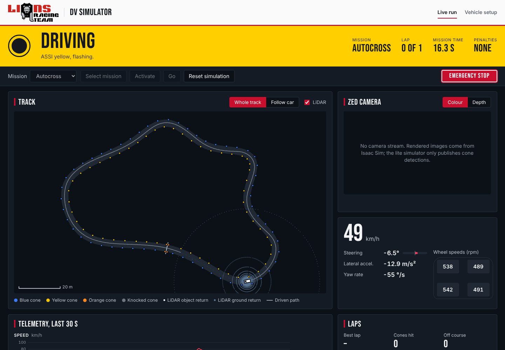
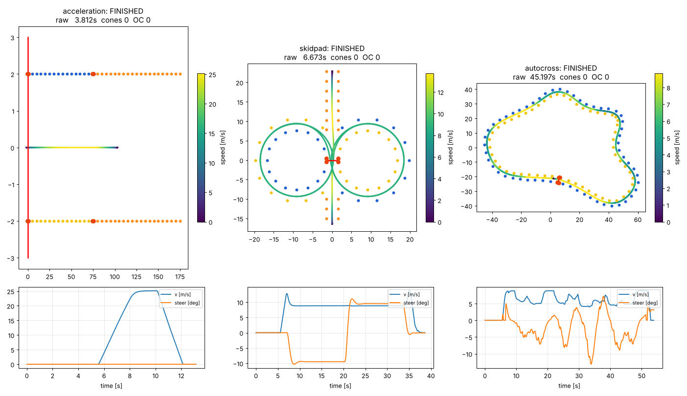
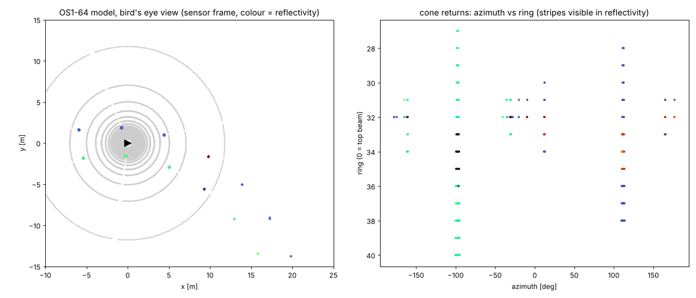
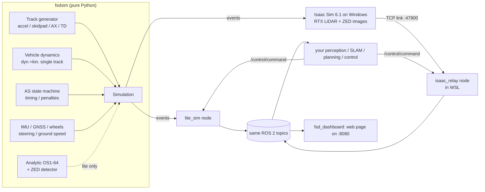

# FSG Driverless Simulator / Digital Twin

A simulator for a Formula Student Germany driverless car. It lets you test the
LiDAR, depth camera and other sensors and run your autonomy stack on every DV
event before the car exists. It is built to grow into the car's digital twin,
with a dashboard on top.

> **Quick start on Windows:** keep the project in a Windows folder (e.g. `C:\formula_student\fsg-dv-sim`) and
> double-click **`run.bat`** (or a copy of it next to the folder). It opens the launcher (http://localhost:8070),
> where you start Isaac Sim, the lite simulator or the offline demo, the dashboard, RL training and the
> Performance tools without any terminal. See [docs/LAUNCHER.md](docs/LAUNCHER.md).

* **Two interchangeable backends, one ROS 2 interface**
  * **lite**: no GPU. Analytic Ouster OS1-64 ray-caster and ZED-style cone detector. Runs anywhere at 5-10x real time, good for CI.
  * **Isaac Sim 6.1** (Windows or Linux): RTX LiDAR and rendered ZED left/right/depth images. On Windows it streams everything to ROS 2 in WSL over a single TCP link, so no DDS has to cross the Windows/WSL boundary.
* **Shared core (`fsdsim`, pure Python)**
  * vehicle dynamics
  * FSG track layouts
  * AS state machine with FS CAN state codes
  * lap timing and penalties
  * IMU, GNSS, wheel-speed, steering and ground-speed models
* **Events:** acceleration, skidpad, autocross, trackdrive, EBS test.
* **Reference driver:** closes the loop out of the box. Replace it with your own stack.
* **Data logger:** optional log of the mandatory DV CAN frames (0x500 / 0x501 / 0x502) in `candump` format.
* **Performance department LapSim (MATLAB) in the repo** (`lapsim/LR26_LapSim`): the simulator reads its car from `lr26_params.m`, so one file drives MATLAB and the simulator. LapSim's physics and events are ported line by line (identical results on all four events), and a parameter-study tool compares LapSim, the DV target and the closed-loop simulation. See [docs/PERFORMANCE.md](docs/PERFORMANCE.md).
* **Performance Lab (`perf/`, Windows: double-click `Performance Lab.bat`; it installs what it needs and opens its own launcher window and a user guide):** the lap time simulation on its own for the Performance department, with no WSL, ROS or Isaac. It covers the events with points and traces, sensitivities, sweeps, 2-D maps, setup comparison, a transient lap (dynamic model + driver) against QSS, energy and the endurance power cap, ggV, correlation with car logs (MF4/CSV) including the motor efficiency map, and a Methods page: minimum-time optimal control (point mass, single / double track, torque vectoring), a comparison of all lap time methods and a Monte-Carlo robustness study. See [docs/PERF_APP.md](docs/PERF_APP.md) and [docs/PERF_METHODS.md](docs/PERF_METHODS.md).
* **Technical papers** (`docs/paper/`): both simulations written up in publication format (PDF + LaTeX), with every equation, method and result. See [docs/paper/README.md](docs/paper/README.md).
* **LR26 CAD:** the four STEP files of the car are read as text (wheelbase, track, wheel radius agree with LapSim to the millimetre), the cone-hit footprint follows the wings, and `tools/cad_to_usd.py` turns the CAD (STEP with cadquery, or STL / OBJ from NX; the whole-car `Assem1.obj` is already converted) into the USD body and wheels that Isaac Sim loads. See [docs/CAD.md](docs/CAD.md).
* **Ideas from the previous Performance code (LionsLTS):** spline tracks, the team's real FSA 2025 autocross / endurance tracks, an endurance energy-budget power cap, import of LionsLTS vehicle files, an MF4 (CAN log) reader, CSV export for Marple and a real-track importer that lays cones around a GPS or x,y line. See [docs/LIONSLTS.md](docs/LIONSLTS.md).
* **RL driver** (learned throttle and brake): trained per vehicle specification by imitation and evolution strategies on fsdsim's physics (NumPy only, CPU). Train it from the dashboard or `tools/train_rl.py`; drive with `longitudinal:=rl`. See [docs/RL.md](docs/RL.md).
* **Camera cones (YOLO):** a YOLO11 model finds the cones and their colour in the ZED image; with the depth image they become a cone map the driver steers from. Training images and labels are recorded automatically in Isaac Sim (labels from the ground truth, hidden cones removed with the depth image); training runs on the GPU from the launcher; the dashboard shows the boxes and the accuracy. See [docs/PERCEPTION.md](docs/PERCEPTION.md).
* **Universal RL driver (GPU / Isaac Lab):** one PPO policy for every vehicle setup in a range. It is trained on thousands of LR26 variants at once on fsdsim's own car model with the LapSim forces, batched on the GPU, and its inputs include the car's specification. Any setup the Performance department applies inside the range is driven right away, with no retraining. It comes with parameter studies (`param_study.py --driver rl`) and fast setup sweeps (`tools/rl_spec_sweep.py`). Train with PyTorch, with Isaac Lab + RSL-RL, or on the CPU. See [docs/RL_UNIVERSAL.md](docs/RL_UNIVERSAL.md).
* **Vehicle setup page** in the dashboard: enter parameter values, then LapSim, MATLAB (in the background) and the running simulation all use them; configurations are saved for the team.
* **Nov 2026 additions:** chassis roll / pitch / heave, wheel slip and an optional double-track model ([docs/ARCHITECTURE.md](docs/ARCHITECTURE.md)); racing line, motor efficiency map, ggv map, solver plug-ins and closed-loop endurance ([docs/PERFORMANCE.md](docs/PERFORMANCE.md)); LiDAR cone detection, LiDAR + camera fusion, SLAM without ground truth, explore-then-race and sensor fault injection ([docs/PERCEPTION.md](docs/PERCEPTION.md)); launcher options for all of it, a regression run and an installation check ([docs/LAUNCHER.md](docs/LAUNCHER.md), [docs/INSTALL.md](docs/INSTALL.md)).
* **WSL with Zenoh** like the Go2 setup: `fsgsim` alias (nothing sourced in `.bashrc`), Zenoh router `fsgrouter`. See [docs/WINDOWS_WSL.md](docs/WINDOWS_WSL.md).
* **Web dashboard** (`fsd_dashboard`): http://localhost:8080. It shows:
  * live AS state, styled after the car's ASSI;
  * the track map with LiDAR returns and the ZED camera;
  * telemetry, laps and penalties, and sensor health;
  * Go / Emergency stop / Reset buttons.

  It starts with the launch files and works with both backends and later the real car (see [docs/DASHBOARD.md](docs/DASHBOARD.md)). It uses the Lions Racing Team identity: logo, racing red, Bebas Neue headings.





---

## Architecture



Your stack only ever sees the topic contract below, so it runs unchanged on the
lite backend, on Isaac Sim, and later on the real car.

## Topic contract

| Topic | Type | Notes |
|---|---|---|
| `/lidar/points` | `sensor_msgs/PointCloud2` | ouster-ros fields: x y z intensity t reflectivity ring range; motion-distorted like the real sensor |
| `/zed/zed_node/{left,right}/image_rect_color`, `.../camera_info`, `/zed/zed_node/depth/depth_registered` | `sensor_msgs/Image`, `CameraInfo` | Isaac backend (ZED ROS 2 wrapper naming) |
| `/zed/detections` | `fsd_sim_msgs/ConeArray` | lite backend stand-in for camera perception (stereo depth noise) |
| `/imu/data` | `sensor_msgs/Imu` | 200 Hz, noise + bias random walk |
| `/gnss/fix`, `/gnss/vel` | `NavSatFix`, `TwistWithCovarianceStamped` | 10 Hz, ENU velocity |
| `/vehicle/sensors` | `fsd_sim_msgs/VehicleSensors` | wheel rpm, steering angle, optical ground speed |
| `/as/status` | `fsd_sim_msgs/ASStatus` | AS state / mission use the FS DV CAN codes |
| `/control/command` | `ackermann_msgs/AckermannDriveStamped` | **input**: `drive.steering_angle` [rad], `drive.acceleration` [m/s²] |
| `/as/select_mission`, `/as/activate`, `/as/go`, `/as/emergency`, `/sim/reset` | services | ASMS / RES emulation |
| `/ground_truth/odom`, `/ground_truth/cones`, `/ground_truth/centerline`, `/ground_truth/markers`, TF `map→base_link` | | for evaluation and the demo driver; turn off `publish_gt_tf` once your SLAM publishes the TF |

Static TFs (`base_link → os_lidar, imu_link, gnss_link, zed_*`) are published by the
simulator node from `sensors.yaml`, so a sensor mount is defined in exactly one place.
In Isaac mode the relay receives the config from Isaac when it connects.

## Quick start: lite backend (ROS 2 Jazzy, no GPU)

```bash
sudo apt install ros-jazzy-rmw-zenoh-cpp ros-jazzy-ackermann-msgs python3-numpy python3-yaml
bash ~/fsg-dv-sim/tools/wsl/setup_shell.sh && source ~/.bashrc     # fsgsim / fsgrouter / fsgbuild aliases
fsgbuild
fsgrouter                                                            # terminal 1: Zenoh router
fsgsim && ros2 launch fsd_sim_bringup lite.launch.py mission:=skidpad   # terminal 2
```

RViz opens following the car. The reference driver performs the AS sequence
(Ready, then Go after 5 s) and drives the event. Other options:

```bash
ros2 launch fsd_sim_bringup lite.launch.py mission:=trackdrive seed:=11        # another random circuit
ros2 launch fsd_sim_bringup lite.launch.py mission:=autocross vehicle_set:="m=300 mux*1.05"   # other car parameters
ros2 launch fsd_sim_bringup lite.launch.py mission:=autocross driver:=false    # your stack drives
ros2 launch fsd_sim_bringup lite.launch.py track_file:=$(ros2 pkg prefix fsd_sim_bringup)/share/fsd_sim_bringup/tracks/trackdrive_seed11.csv mission:=trackdrive
ros2 service call /as/emergency std_srvs/srv/Trigger                          # press the RES
ros2 topic echo /as/status
```

To drive manually or step through the AS yourself, set `auto_go: false` in
`sim.yaml` and call `/as/go` once the car has been in AS Ready for 5 s.

## Isaac Sim backend: Windows 11 (Isaac Sim 6.1 / Isaac Lab 3.0) + WSL2 (ROS 2 Jazzy)

Step-by-step guide: **[docs/WINDOWS_WSL.md](docs/WINDOWS_WSL.md)**. Backend details: [docs/ISAAC.md](docs/ISAAC.md). In short:

```bash
# WSL (Ubuntu 24.04, ROS 2 Jazzy): terminal 1 = fsgrouter, terminal 2:
fsgsim && ros2 launch fsd_sim_bringup isaac.launch.py
```
```powershell
# Windows PowerShell - Isaac Sim 6.1 in C:\isaacsim (or -Python <Isaac Lab env>\python.exe)
powershell -ExecutionPolicy Bypass -File \\wsl.localhost\Ubuntu-24.04\home\<you>\fsg-dv-sim\isaac\run_isaac.ps1 -Mission skidpad
```

On native Linux: `ISAAC_SIM=~/isaacsim ./isaac/run_isaac.sh --mission skidpad`.

## New computer

[docs/INSTALL.md](docs/INSTALL.md) installs everything from zero (WSL 2, ROS 2 Jazzy, Isaac Sim 6.1, optional
GPU training and MATLAB); `python3 tools/check_install.py` says what is missing.

## Without ROS: tests and closed-loop evaluation

**CI:** GitHub runs the unit tests on every push (`.github/workflows/tests.yml`, Python 3.12, numpy / scipy / pyyaml /
casadi / OpenCV; packages in `tools/ci/requirements-ci.txt`). `tools/ci/tests.yml` is a copy of the workflow: if the
`.github` folder is missing, copy it to `.github/workflows/tests.yml`. The confidential LapSim folder is not in git, so the tests that need the LR26 skip there and
`tests/test_testcar.py` runs the Performance Lab on a fictional test car (`tests/fixtures/testcar_lapsim`) instead.
ROS 2, Isaac Sim and PyTorch tests skip as well. The full suite, with the LR26, still runs on the team PC.

What still has to be run on the team PC (Isaac Sim, MATLAB, GPU) and what to expect: [docs/TEST_PLAN.md](docs/TEST_PLAN.md).

```bash
python3 -m unittest discover -s tests -v          # 346 tests (incl. the LapSim port against the team's LapSim results)
python3 tools/link_check.py serve                 # + 'connect --host <WSL IP>' on Windows: link latency / bandwidth
python3 tools/closed_loop_eval.py --strict        # drives all events, fails on cones / off-course / DNF
python3 tools/closed_loop_eval.py --missions skidpad --lidar --plot out/ --set m=300
python3 tools/closed_loop_eval.py --rate 20 --strict          # driver at your stack's control rate
python3 tools/param_study.py --param c_z --values 3.5,4.15,4.8   # LapSim vs DV target vs closed-loop sim, HTML report
python3 tools/param_study.py --table                             # +-10 % sensitivity table
python3 tools/endurance_strategy.py --budget-kwh 5.9             # endurance power cap from an energy budget (LionsLTS idea)
python3 tools/track_import.py line.csv --closed --cones out/track.csv --png   # real line -> cone layout (then closed_loop_eval.py --track-file)
python3 tools/cad_inspect.py cad/lr26/*.stp --png out/cad.png    # what the CAD contains and how it compares with the model
python3 tools/mf4_summary.py log.mf4                             # statistics of a CAN log (.mf4)
python3 tools/log_correlate.py log.mf4 --lapsim-effect           # motor efficiency, roll-out check, effect on the endurance cap
python3 tools/generate_tracks.py --seeds 1 2 3 --png
python3 tools/regression.py                                      # 33 closed-loop cases: events, circuits, perception, faults
python3 tools/racing_line.py --mission trackdrive --seed 7 --png out/line.png   # racing line and its gain
python3 tools/closed_loop_eval.py --mission trackdrive --laps 3 --perception lidar --slam --race-after 1 --line racing
python3 tools/closed_loop_eval.py --mission autocross --perception fusion --slam --faults lidar:dropout@14+1.5
python3 tools/ggv_map.py --png ; python3 tools/solver_compare.py ; python3 tools/endurance_closed_loop.py --budget-kwh 0.45
```

Reference results with the LR26 (performance model) and the reference driver (perfect perception):

| Event | Result | LapSim (same car) |
|---|---|---|
| Acceleration | 4.77 s, stopped inside the exit lane | 4.66 s |
| Skidpad | 5.38 s average of the two timed laps | 5.15 s |
| Autocross, map-based | 20.1 s (`param_study`) | 17.5 s at the tyre limit |
| Autocross, map-based, racing line (`--line racing`) | 19.5 s | - |
| Autocross with LiDAR + camera cones and SLAM pose (no ground truth) | 42.7 s, map 113 of 113 cones, pose error 0.04 m | - |
| Trackdrive, explore one lap then race on the mapped track | lap 1 about 40 s, then 18.7-19.6 s | - |
| Autocross / trackdrive, exploration-style (cone-based planner, 9 m/s cap) | 44.8 s per lap | - |
| EBS test | 21.5 m stopping distance | - |

All runs finish with 0 cones and 0 off-course, at a driver rate of 50, 25 or 20 Hz (skidpad until 9 Nov 2026: 5.49 s, and
one cone at 20-25 Hz with the CAD front wing; see docs/CAD.md). The gap to LapSim is mostly the DV driver's grip
margin (80 % lateral, 56 % braking); see [docs/PERFORMANCE.md](docs/PERFORMANCE.md).

## Configuration

Everything is in `ros2_ws/src/fsd_sim_bringup/config/`:

* **`vehicle.yaml`**: the LR26 in `model: performance`. It holds yaw inertia, actuator limits and lags, the footprint, and run-time `performance_changes`.
* **`lapsim/LR26_LapSim/config/lr26_params.m`**: the LapSim parameters, read directly (`vehicle.yaml: performance_source: lapsim`). `performance_lr26.yaml` is a fallback copy (`tools/import_lapsim_params.py`).
* **`vehicle_generic.yaml`**: the previous generic car (`model: single_track`: mass, geometry, aero, Pacejka tyre, power).
* **`sensors.yaml`**: OS1-64 (channels, FOV, resolution, rate, noise, mount, Isaac profile), ZED (baseline, FOV, resolution, mount), IMU, GNSS (origin, noise), wheel / steering / ground-speed sensors.
* **`sim.yaml`**: mission, track seed or CSV, event geometry, penalties, and AS timing (Ready → Go delay, EBS decel, watchdog).

Tracks import and export as EUFS/FSSIM-style CSV (`tag,x,y,direction,...`).

## Repository layout

```
ros2_ws/src/
  fsdsim/            core library (no ROS imports) - also used by Isaac and tools
  fsd_sim_msgs/      Cone, ConeArray, ASStatus, VehicleSensors, SelectMission
  fsd_sim_bridge/    lite_sim, isaac_relay, demo_driver nodes + shared ROS converter
  fsd_sim_bringup/   launch files, config, RViz layout, example tracks
  fsd_dashboard/     web dashboard: ROS node, offline demo, HTTP/SSE server, web page
  fsdsim/fsdsim/perf/  LR26 LapSim port (model, events and scoring, QSS solver, parameters)
  fsdsim/fsdsim/rl/    RL throttle / brake: policy (NumPy), training scenarios, evolution strategies
  fsdsim/fsdsim/vec/   batched (GPU) car model, universal-policy environment, PPO (NumPy / PyTorch)
perf/                Performance Lab: stand-alone lap time simulation web app (perf.bat)
lapsim/LR26_LapSim/  the Performance department's MATLAB LapSim (source of the vehicle parameters)
lapsim/configs/      parameter configurations saved from the dashboard's Vehicle setup page
rl/policies/         trained RL throttle / brake policies (per vehicle spec, and the universal policy)
isaaclab/fsd_rl/     Isaac Lab task (RSL-RL) for the universal policy
isaac/               Isaac Sim backend: run_isaac.py, run_isaac.ps1 (Windows), scene, RTX sensor streams, version shims
tools/               closed-loop evaluation, parameter studies, LapSim import, track generator, RL training / sweeps
tools/launcher/      the web launcher started by run.bat (http://localhost:8070)
run.bat              Windows: double-click to open the launcher
tools/wsl/           fsgsim environment + .bashrc setup (Zenoh, Go2 style)
tools/regression.py  closed-loop regression run (events, circuits, perception, faults)
tools/check_install.py  what is installed, what is missing
tests/               unit tests
docs/                architecture, Isaac setup, plots
```

## Roadmap to a digital twin

1. **Now: simulator.** Sensors, events, AS logic, ROS 2 contract, CI evaluation.
2. **Dashboard.** Version 1 is done (`fsd_dashboard`). It runs on the same topics, so it works for the sim and the car:
   * live map with cones, path, car and LiDAR returns;
   * AS state (ASSI), mission and lap timing, penalties;
   * sensor health by stamp rate and staleness;
   * ZED colour and depth;
   * steering, acceleration and speed traces;
   * AS buttons.

   Added Nov 2026: mapped cones and map / pose accuracy against the ground truth, per-sensor delay.
   Next: rosbag replay and run comparison.
3. **Digital twin.**
   * Identify `vehicle.yaml` from car logs (coast-down, step-steer, skidpad).
   * Calibrate sensor noise from recorded data and import surveyed FSG track maps.
   * Replay real control inputs and compare sim and car.
   * Run hardware-in-the-loop against the DV computer through the DV CAN frames.
4. **Competition readiness.**
   * Regression runs on all events and many seeds: done (`tools/regression.py`, launcher job).
   * Fault injection (sensor dropout, GNSS jump, latency, gyro bias, thinned LiDAR): done (`fsdsim.faults`).
   * EBS / RES scenarios.

## Assumptions to verify

* **LiDAR model.** "Ouster LS1 64" was taken to be an **Ouster OS1-64**, the 64-channel OS1. If it is a different unit, change `sensors.yaml` (channels, FOV, resolution, range, Isaac profile).
* **Isaac 64-channel profile.** Isaac Sim ships OS1 profiles for 32 and 128 channels. If no 64-channel profile is listed, the backend falls back to the nearest one and logs a warning. See docs/ISAAC.md.
* **Rule values.** Event dimensions, penalties and AS timing follow commonly used FS rule values. Check them against the FS Rules for your season (chapter D, T 14 / T 15) and the FS Driverless Specification, then adjust `sim.yaml`.
* **Vehicle parameters.** These are generic FS electric 4WD values, not your car.

## Known limitations

* **Flat ground.** The track is flat. The body rolls, pitches and heaves and the wheel speeds include slip (Nov 2026), with typical FS values that are not measured on the LR26 (`vehicle.yaml` → `chassis:`).
* **Perception chain.** LiDAR + camera (YOLO) fusion with SLAM drove autocross and a full trackdrive (explore, then race at 18.8 s per lap) in Isaac Sim on the team PC (11 Nov 2026, docs/TEST_PLAN.md). The SLAM pose error there is 0.2-0.4 m (lite 0.05 m; the RTX LiDAR cones are noisier); LiDAR-only cones have no colours in Isaac and the driver follows the boundaries by geometry (autocross finished). A gyro bias of 0.02 rad/s makes the SLAM pose drift by metres (no bias estimation yet).
* **Lite camera.** The lite backend outputs camera detections, not images.
* **Cones in Isaac.** Cone contact uses the analytic footprint check in both backends; there is no PhysX cone physics.
* **Isaac backend.** Verified on Isaac Sim 6.1 (Windows 11, RTX 5060 Laptop) with ROS 2 Jazzy in WSL:
  * the RTX OS1 at 10 Hz;
  * ZED colour and depth;
  * all missions with the reference driver, the RL driver, YOLO and fusion + SLAM (11 Nov 2026, docs/TEST_PLAN.md).

  It runs at about 0.85x real time on an 8 GB laptop GPU on ground truth, 0.7x with full camera images for YOLO. `isaac/isaac_compat.py` keeps the fallbacks for other Isaac versions.
