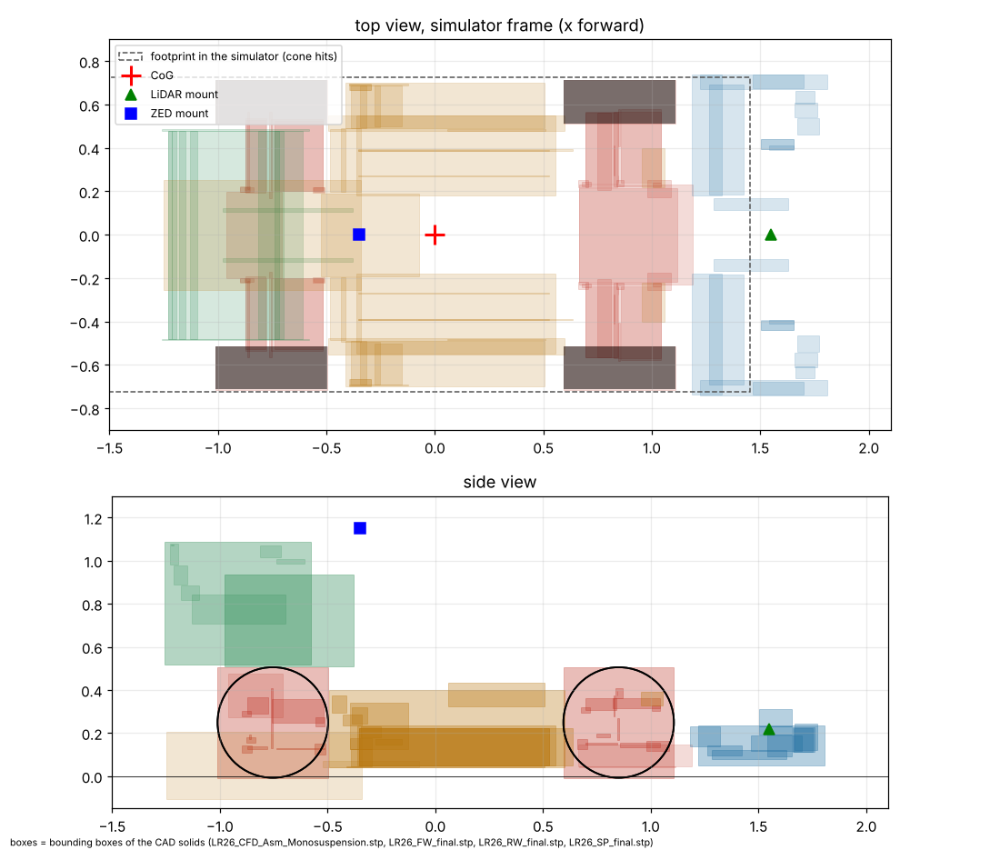
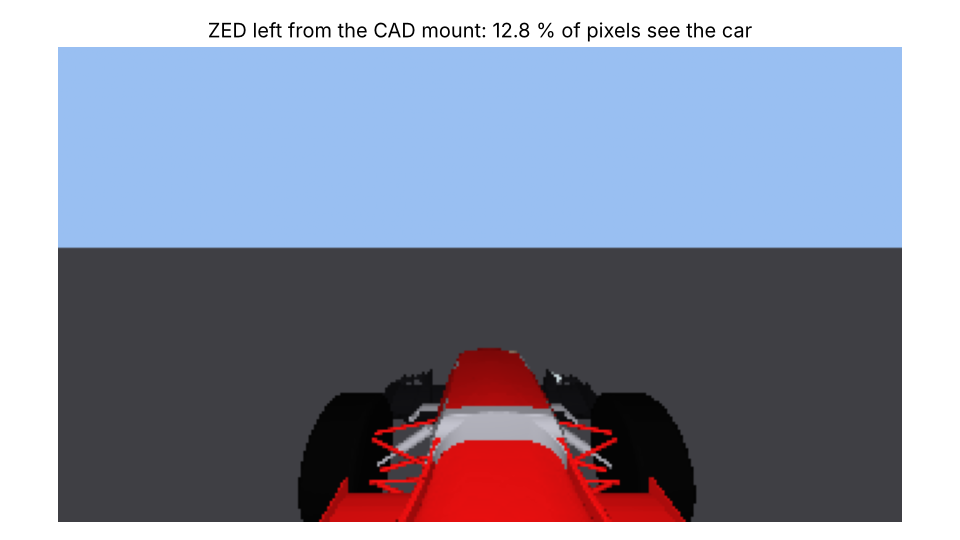
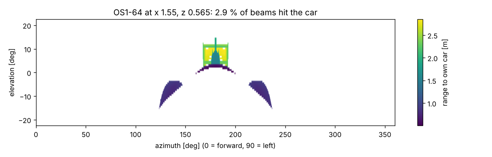

# The LR26 CAD in the simulator

The four STEP files of the car (`LR26_FW_final`, `LR26_RW_final`, `LR26_SP_final`, `LR26_CFD_Asm_Monosuspension`,
NX 2206, millimetres) are in `cad/lr26/`. This page says what is in them, what already follows them in the
simulator, and how to show the CAD in Isaac Sim.

## What the CAD contains (read with `tools/cad_inspect.py`)

| File | Content | Extent in the simulator frame (x forward, origin at the CoG on the ground) |
|---|---|---|
| `LR26_CFD_Asm_Monosuspension` | 4 wheels (tyre = torus), push / pull rod suspension as thin plates, nose, rear structure | wheels at x = +0.851 / -0.754 m, y = +-0.613 m, hub height 0.249 m |
| `LR26_FW_final` | front wing, 22 solids | 1.18 .. 1.81 m ahead of the CoG, 1.48 m wide, z 0.05 .. 0.31 m |
| `LR26_SP_final` | sidepods, floor, diffuser, 34 solids | x +1.06 .. -1.25 m, 1.40 m wide |
| `LR26_RW_final` | rear wing, 11 solids | 0.38 .. 1.26 m behind the CoG, 0.97 m wide, z 0.51 .. 1.09 m |

The four files share one frame: the front axle is at x = 0, x points to the rear, z up (CAD frame).
The CFD assembly has **no monocoque, cockpit or main hoop**, so the camera hoop is not in it.

**The CAD agrees with the LapSim parameters**: wheelbase 1.605 m, track 1.2264 m front and rear, wheel centre
height 0.249 m (= `circ_ref` / 2 pi), tyre 0.2565 m outer radius and 0.2007 m wide. The centre of gravity
(`lf` = 0.85065 m) is therefore 850.65 mm behind the front axle in the CAD.



## What already changed in the simulation (no 3D model needed)

`vehicle.yaml` -> `footprint` (used for cone hits and the start position) now follows the CAD: front overhang
0.956 m (front wing tip, was 0.60), rear overhang 0.504 m (was 0.82), width 1.48 m, length 3.065 m. Closed-loop runs
are unchanged (acceleration 4.77 s, skidpad 5.49 s, autocross and 10-lap trackdrive without cones or off-course)
with the driver at 50 Hz. At 20-25 Hz (the RL harness, slower stacks, the ROS demo driver under load) the wider
front wing touched a skidpad cone: the reference driver ran ~0.2 m wide on the circles. Since 9 Nov 2026 it steers
for where the car will be after the steering lag (`DriverParams.steer_preview`, 0.05 s): skidpad 5.38 s, clean at
20, 25 and 50 Hz (`tools/closed_loop_eval.py --rate 20`).

## Showing the CAD in Isaac Sim

The simulator already loads a USD model (`usd_path`, visual only; dynamics do not change). What is missing is
the USD file, because a STEP file holds exact surfaces (B-splines, planes, tori) that have to be turned into
triangles first. That needs a CAD kernel (OpenCascade), which is not part of the simulator. Two ways:

**A. From STEP, with cadquery** (WSL, once: `python3 -m venv ~/cadvenv && ~/cadvenv/bin/pip install cadquery numpy pyyaml`):

```bash
cd /mnt/c/formula_student/fsg-dv-sim
~/cadvenv/bin/python tools/cad_to_usd.py cad/lr26/*.stp --set-yaml
```

**C. From the whole-car OBJ** (what is shipped: `Assem1.obj`, an assembly export in **centimetres**, 680 parts with
Autodesk colour names). No extra package:

```bash
python3 tools/cad_to_usd.py Assem1.obj --unit-scale 0.01 --set-yaml --hoop --move-lidar
```

Result for `Assem1.obj`: 680 body parts, 420 k triangles (45 MB USDA), four wheels of one part each (1258 triangles).
Parts with more than 12 000 triangles (springs, dampers, threads, tessellated far finer than visible) are reduced by
vertex clustering (`--max-part-tris`, 0 = never): 974 k -> 425 k triangles. The OBJ has no colours, so `--paint auto`
guesses: wings carbon, rods grey (wishbones, push / pull and tie rods: long with a small round section), parts
larger than 0.30 m red, the rest grey (`--paint none` for one flat colour). Wheels are always tyre black. In Isaac
Sim, `isaac/scene.py` turns these colours into real materials (see [ISAAC.md](ISAAC.md)).

**B. From STL or OBJ** exported by NX (File > Export > STL / OBJ; millimetres; give the assembly of the wings,
sidepods, suspension and wheels, as one file or several). No extra package:

```bash
python3 tools/cad_to_usd.py cad/lr26/export/*.stl --set-yaml
```

The tool writes `assets/lr26/lr26_body.usda`, `lr26_wheel_fl|fr|rl|rr.usda` and `lr26_cad.json`, and with
`--set-yaml` puts `usd_path` and `usd_wheel_path` into `vehicle.yaml`. Then start the simulation again.

* **Frame:** millimetres, front axle at CAD x = 0, x to the rear are the defaults (`--unit-scale`,
  `--front-axle-x`, `--x-forward` for other models). The tool prints the extent in the simulator frame; the lowest
  point must be at z = 0.
* **Wheels:** parts that lie completely inside a wheel's envelope (tyre radius 0.2565 m, width 0.2007 m around the
  hub the dynamic model uses) become that wheel, centred on its hub, so they steer and spin. A single mesh of the
  whole car is split by triangle instead (from the hub radius outwards, so the upright stays with the body).
  If a wheel is not found the simulator keeps its cylinder for it, and the tool says so.
* **Filler:** the CFD model has no tub and no hoop, so `usd_fill_body: true` (`--filler`) adds a simple monocoque
  box and the main hoop under the camera (as in the procedural car). The whole-car OBJ has the monocoque but no main
  hoop above the helmet (the ZED mount floats), so it ships with `usd_fill_body: false`, `usd_fill_hoop: true`
  (`--hoop`).
* **Sensors:** the tool checks the OS1's own body at the LiDAR mount (a cylinder 87 mm wide, 73.5 mm high, + 5 mm):
  model vertices inside it and triangles cutting it. In the whole-car OBJ the nose is a hollow shell around the old
  LiDAR mount (x 1.55, z 0.22), so `--move-lidar` raised it in `sensors.yaml` to z = 0.565 m, on top of the nose; a
  second run reports 0 (until 9 Nov 2026 a 12 cm sphere was used, which still warned for a sensor sitting on the
  nose). **To undo: set `z: 0.22` in `sensors.yaml`.** The ZED mount (x -0.35, z 1.15) has nothing within 12 cm.
* **What the sensors see of the car** (ray-cast of the shipped USD, 9 Nov 2026, not yet compared with Isaac): the ZED
  left image shows the car in its bottom third (nose, front tyres, push rods: 13 % of the pixels; helmet and hoop out
  of view). The OS1 front half is free (lowest beam reaches the ground 1.36 m ahead); in the rear half about 3 % of
  all beams hit the car beyond 0.5 m (front tyres at +-130 deg, helmet / rear wing at 180 deg) and about 13 % hit the
  nose closer than 0.5 m. The Isaac cloud is published as the RTX sensor returns it (no self-filter), so these
  points reach `/lidar/points`; a cone detector should drop points inside the car's footprint.

  
  
* **Size:** the normals make files larger (about 110 bytes per triangle); `--no-normals` halves it.
* **Confidential CAD:** `cad/**/*.stp` is in `.gitignore`; remove that line to commit the files.

## Not done / to check

* **Not tested in Isaac Sim.** The OBJ was converted and checked as point views (side and top: nose, monocoque,
  helmet, wings and wheel positions line up with the dynamic model), but the USD files have not been loaded in
  Isaac. On 9 Nov 2026 `isaac/scene.py` was built with OpenUSD (usd-core 26.11, no Isaac): no composition errors,
  body x -1.258..+1.806 m, lowest body point 4 cm above the ground, wheels on their hubs while steering and spinning
  (radius 0.257 m, 7 mm into the ground = tyre deflection), cameras at x -0.35, z 1.15, 6.9 deg down; and the
  shipped USD went through `cad_to_usd.py` again (back to an OBJ in centimetres) and came out identical. The STEP reader, the mesh tools, the frame, the wheel split and the USD writer are
  unit-tested with synthetic cars, and the STEP files were read for real, but the STEP tessellation (cadquery) and
  the USD loading in Isaac could not be run in the environment where this was built (no CAD kernel, no Isaac).
* The first conversion should be checked in the viewport: wheels where the dynamic model has them, nothing floating,
  nothing sunk into the ground.
* The CFD surfaces are simplified (rods as plates); the look is that of a CFD model.
* The inspector's bounding boxes are approximate (vertices and B-spline control points); the SP file shows
  z = -0.105 m at the diffuser, which is probably a control point below the surface.
* The aerodynamics of the simulation still come from LapSim (`c_w`, `c_z`, `aero_bal_f`); the CFD geometry is
  not used for forces.
