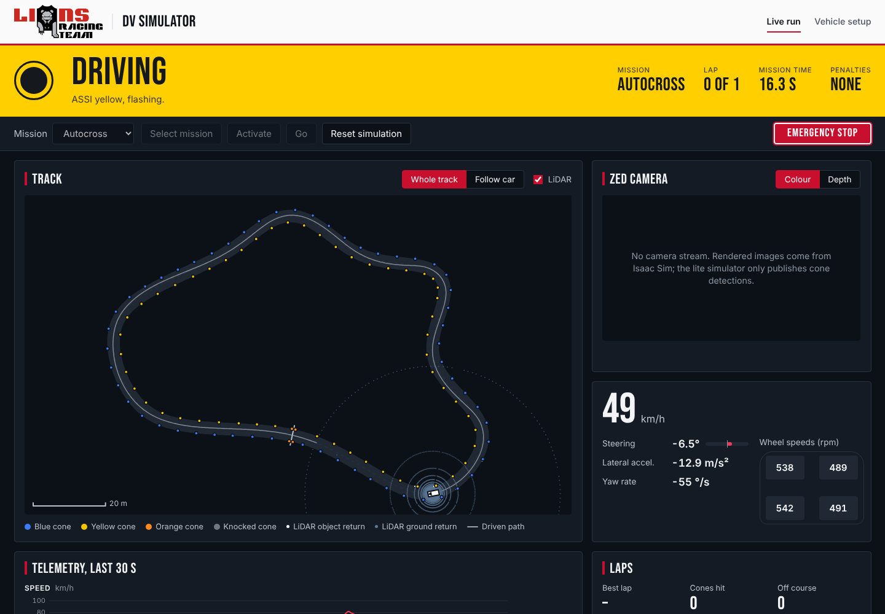
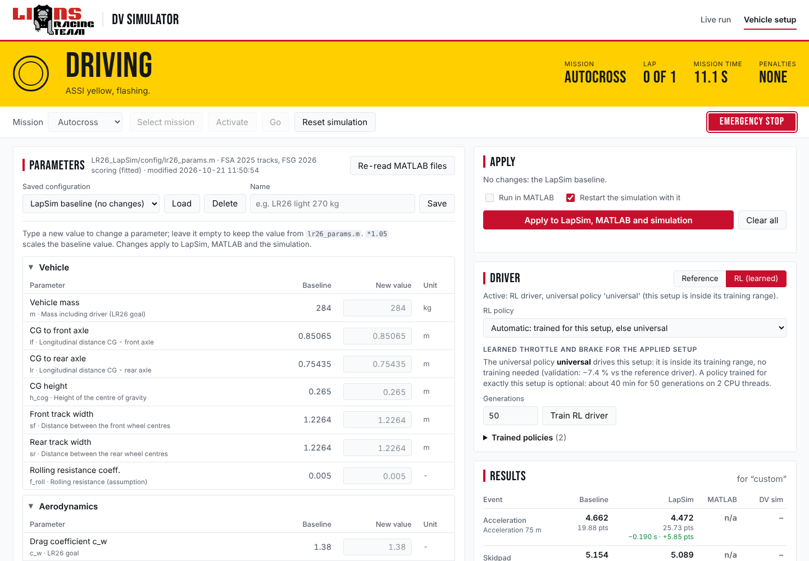

# Dashboard

A live web page for the simulator and, later, the car. It runs as a ROS 2 node in
WSL / Linux and is opened in any browser. On Windows, use **http://localhost:8080**.

It uses the **Lions Racing Team** identity from lionsracing.de:
* the team logo in a white header with a red rule (white in both themes, as on the site, so the logo's black parts stay visible);
* the site's colours: racing red `#c8102e`, near-black `#0c1118`, steel grey, and the gold accent `#b8860b` for changed parameters;
* **Bebas Neue** for headings and big numbers (bundled as `web/bebas-neue.woff2`, SIL Open Font License, see `web/FONT-LICENSE.txt`), with the system UI font for text.

Only the ASSI band keeps its rulebook colours (yellow / blue). The logo files (`lions-logo.png`, `favicon.png`, `apple-touch-icon.png`) belong to the team.



*(Offline demo without a camera stream. With Isaac Sim the ZED panel shows the rendered view.)*

## Starting it

The launch files start it by default:

```bash
ros2 launch fsd_sim_bringup isaac.launch.py            # Isaac Sim on Windows + relay + RViz + dashboard
ros2 launch fsd_sim_bringup lite.launch.py             # lite backend + dashboard
ros2 launch fsd_sim_bringup isaac.launch.py dashboard:=false
ros2 launch fsd_sim_bringup isaac.launch.py dashboard_port:=8090
```

On its own, next to anything that publishes the topic contract (a rosbag, the car):

```bash
ros2 run fsd_dashboard dashboard --ros-args -p port:=8080
```

You can also run it **without ROS**. The offline demo runs the simulator and reference driver in-process, which is handy for showing the dashboard on a laptop without ROS or for working on the page itself:

```bash
ros2 run fsd_dashboard dashboard_demo --mission trackdrive        # after colcon build
cd ros2_ws/src/fsd_dashboard && PYTHONPATH=../fsdsim python3 -m fsd_dashboard.demo --mission skidpad --manual
```

`--manual` leaves the AS sequence to the buttons: Select mission, then Activate, then Go once the 5 s in Ready have passed.

## What it shows

| Panel | Content | Source topics |
|---|---|---|
| **ASSI band** | AS state in the ASSI colours: yellow steady = Ready, yellow flashing = Driving, blue steady = Finished, blue flashing = Emergency. Also mission, lap *n of N*, mission time and penalties. Only the lamp flashes, at 2 Hz. With *reduce motion* switched on, a striped lamp means flashing. | `/as/status` |
| **Controls** | Select mission, Activate, Go, Reset simulation, Emergency stop. Each button is enabled only in the AS states where it applies. | services `/as/select_mission`, `/as/activate`, `/as/go`, `/as/emergency`, `/sim/reset` |
| **Track** | Cones (knocked cones grey and slashed), track surface and centre line, timing and finish lines, driven path, car footprint, and LiDAR returns in the map frame (object returns bright, ground returns faint). You can view the whole track or follow the car. | `/ground_truth/cones`, `/ground_truth/centerline`, `/ground_truth/markers`, `/ground_truth/odom` (or TF `map → base_link`), `/lidar/points/preview` (the bridge's thinned copy, 6000 points per scan; the full cloud slowed Zenoh for every node; another LiDAR source needs such a copy on `<topic>/preview`) + TF |
| **ZED camera** | Left colour image or colourised depth (lighter is nearer, 40 m and beyond darkest), at up to 5 frames/s from the bridge's small previews (the full images through the Zenoh router delayed the driver's data in Isaac Sim). The stream health uses the full-rate `camera_info` and expects the rate Isaac renders at (`isaac.launch.py camera_hz:=`, set by the launcher: 5 Hz, 10 Hz with camera cones). | `/zed/zed_node/left/image_rect_color/preview`, `/zed/zed_node/depth/depth_registered/preview`, `.../camera_info` |
| **Vehicle** | Speed (km/h), steering angle with a left/right bar, lateral acceleration, yaw rate, and the four wheel speeds laid out at the car's corners. | `/ground_truth/odom`, `/vehicle/sensors`, `/imu/data` |
| **Telemetry** | The last 30 s of speed, steering (measured vs command) and longitudinal acceleration (IMU vs command). Hover for exact values at a moment; the cursor is synced across the charts. | same + `/control/command` |
| **Laps** | Best lap, cones hit, off-course count, and every lap time with its gap to the best. | `/as/status` |
| **Sensor health** | Rate per stream, measured from **message stamps**, so a simulator running below real time still shows the rate your stack sees. Also the nominal rate from `sensors.yaml`, and status: OK, Low rate (< 80 % of nominal) or Stalled (nothing for 1.5 s). Control commands show *Idle* outside Ready and Driving. **Delay (ms)**: how old the data is when it arrives (simulation time now minus the message stamp, median; sensor latency plus transport, one clock step of resolution). | all of the above |
| **Events** | AS transitions, laps, cone hits, off-course events, stalled or recovered streams, simulator restarts, and the result of every button press. | derived |

With a perception node running (`perception:=lidar | fusion | camera`) the track panel shows the mapped cones
and, under the map, one line from `/perception/map_stats`: cones mapped, share of the track's cones found,
position error, colour accuracy, and the SLAM pose error against the ground truth. The YOLO line under the camera
image is unchanged.

## Vehicle setup

The second tab (**Vehicle setup**, or http://localhost:8080/#setup) tries parameter configurations
in the Performance department's LapSim, in MATLAB and in the simulation at once.



**Form.** Every parameter of Table 3.1 (documentation v2.0), grouped as in the table, with its
current value from `lapsim/LR26_LapSim/config/lr26_params.m` as the baseline. Leave a field empty to
keep the baseline, type a value, or type a factor such as `*1.05`. Further groups:
* **Driver model friction utilisation:** per event, LapSim and MATLAB only.
* **Driverless car only:** yaw inertia and actuator limits, which only exist in the simulator.

The **Other changes** box takes any change string (`mu*1.05`, `c_z+0.3`).

**Apply** does three things:

| Column | What happens | Time |
|---|---|---|
| **LapSim** | The Python port of LR26_LapSim runs all events of the competition file (FSA 2025 tracks) and scores them. Its results are identical to MATLAB's. | < 1 s |
| **MATLAB** | The real LR26_LapSim runs in the background with the same changes (`lts_set_param`, `lts_run_all`). | 20–60 s (MATLAB start-up) |
| **DV sim** | The running simulator swaps the vehicle and restarts the mission (`/sim/vehicle_set`). Isaac Sim stays open. Each mission that finishes adds its time. | a few seconds, then the run |

Each result shows the time, the points, and the difference to the baseline (green = faster).
Endurance (LapSim, 16 laps of the FSA track) is compared with trackdrive (DV sim, 10 laps of the
simulator's track), and autocross uses different layouts too. For those two, compare how much the
time changes, not the absolute times.

**Driver.** The **Driver** panel picks who works the throttle and brakes in the running
simulation: the **Reference** driver, or **RL (learned)**, a policy trained by reinforcement
learning for the applied setup. Steering always follows the path.
* **Train RL driver** trains one for the applied setup in the background (CPU, all cores but one), with progress and ETA.
* The list shows every trained policy and its time gain over the reference driver on complete missions.
* Finished missions driven by the RL driver carry an **RL** tag in the DV sim column.
* **Universal policy:** when a universal policy covers the applied setup, the panel says so. **RL (learned)**
  then drives the new setup without any training. **RL policy** chooses between *Automatic* (a policy
  trained for exactly this setup, else the universal one), *Universal*, or a named policy. If the setup is
  outside the universal policy's range, the panel names the parameter.

See [RL.md](RL.md) and [RL_UNIVERSAL.md](RL_UNIVERSAL.md).

**Configurations.** **Save** writes `lapsim/configs/<name>.json` (`{"changes": [...], "notes": ...}`);
commit them to share with the team. **Load** fills the form; **Apply** runs it.

**Editing the MATLAB file.** The baseline column follows `lr26_params.m`. After changing that file,
press **Re-read MATLAB files**, or just Apply. The simulator also re-reads the file on every Apply.

**MATLAB files and results (buttons under Results).** *LapSim files* opens `lr26_params.m`, the competition
file, `run_lapsim.m`, the LR26_LapSim folder, the saved configurations, or starts the MATLAB desktop in
LR26_LapSim. *MATLAB results* opens the last MATLAB run: its results table (CSV), MATLAB's output (log), the
generated job script and the results folder. Files open on the PC with their Windows program (`.m` in MATLAB,
`.csv` in Excel), folders in File Explorer. Only these files can be opened, and only from a browser on the PC
that runs the simulator (not from another computer on the network).

### MATLAB from WSL

The dashboard runs Windows MATLAB through WSL interop:

* **Finding MATLAB:** it uses the newest `C:\Program Files\MATLAB\R*\bin\matlab.exe`. Another
  install: `export FSG_MATLAB="C:\Program Files\MATLAB\R2025b\bin\matlab.exe"` before starting
  the dashboard. A Linux `matlab` in the `PATH` works too.
* **Running a job:** before every job, `lapsim/LR26_LapSim` is copied to
  `%LOCALAPPDATA%\fsg-dv-sim\matlab` (`FSG_MATLAB_WORKDIR` to change it). MATLAB therefore never
  works on a `\\wsl.localhost` path, and it always runs the current files.
* **The job script** is `jobs\fsg_job_<n>.m` in that folder, with its log and results CSV. Open it
  in MATLAB to see exactly what ran.
* **One job at a time:** if you press Apply again while MATLAB runs, only the newest configuration
  runs next.

Without MATLAB, the MATLAB column says so and everything else works.

### API

```
GET  /api/setup    parameters with baselines, configurations, active setup, LapSim / MATLAB / sim results
POST /api/setup    {"action": "apply", "changes": ["m=270", "mu*1.05"], "name": "...", "matlab": true, "sim": true}
                   {"action": "save" | "delete", "name": "...", "changes": [...], "notes": "..."}
                   {"action": "reload" | "cancel_matlab" | "validate", ...}
```

## Real car / without ground truth

The page only uses the topic contract. Without `/ground_truth/odom`, it takes the car
pose from TF `map → base_link` (for example from your SLAM) and derives speed from it.
Cones and centre line appear when something publishes `/ground_truth/cones` and
`/ground_truth/centerline`. On the car, that can be your SLAM map republished in the
same format.

## How it works

```
ROS 2 topics ──► fsd_dashboard/node.py ──► model.py (thread-safe state, health, laps, events)
fsdsim (demo) ──► feed.py ──────────────┘          │
                                                    ▼
                                    server.py (stdlib HTTP)
                                    GET  /events          Server-Sent Events, JSON delta every 100 ms
                                    GET  /api/state       full state (for scripts)
                                    GET  /api/image/left  latest JPEG (PNG if neither OpenCV nor Pillow is installed)
                                    POST /api/command     {"cmd": "go"} etc.
                                                    │
                                                    ▼
                                    web/index.html + app.js + style.css (no external libraries, works offline)
```

* **Data per browser.** Each browser receives only what changed: new telemetry rows, new events, and the track, cones or LiDAR only when they update. LiDAR is thinned to at most 6000 points and sent as int16 at 2 cm resolution. Images are fetched separately, so a slow browser never blocks the stream.
* **Scripting.** `GET /api/state` and `POST /api/command` make the dashboard scriptable:

  ```bash
  curl -s localhost:8080/api/state | python3 -m json.tool | head
  curl -s -X POST localhost:8080/api/command -d '{"cmd": "emergency"}'
  ```

## Parameters (`ros2 run fsd_dashboard dashboard --ros-args -p ...`)

| Parameter | Default | Meaning |
|---|---|---|
| `host` | `0.0.0.0` | interface to listen on |
| `port` | `8080` | HTTP port |
| `config_dir` | bringup `config/` | where topic names, nominal rates and car size come from |
| `image_hz` | `8.0` | max camera frames per second encoded for the page |
| `lidar_hz` | `10.0` | max LiDAR clouds per second sent to the page |
| `source` | `ROS 2` | label in the page footer |

## Troubleshooting

* **The page does not load from Windows.** WSL forwards `localhost` ports to Windows by default; mirrored networking does too. If it still fails, open `http://<WSL IP>:8080`, where the WSL IP comes from `hostname -I` in WSL.
* **"Not connected" in the band.** The page lost its stream: the launch was stopped or crashed. The page reconnects by itself.
* **Map empty, but the band shows a state.** No `/ground_truth/centerline` or cones yet. They are latched, so check `ros2 topic echo /ground_truth/cones --once --no-daemon`.
* **Camera "Low rate".** The rate is compared with `camera.rate_hz` in `sensors.yaml`, or with `camera_hz` when the launcher started Isaac with a lower `--camera-hz` (fixed 11 Nov 2026; before it showed "Low rate" at 5-10 Hz). Started by hand: `isaac.launch.py camera_hz:=<the -Extra --camera-hz value>`.
