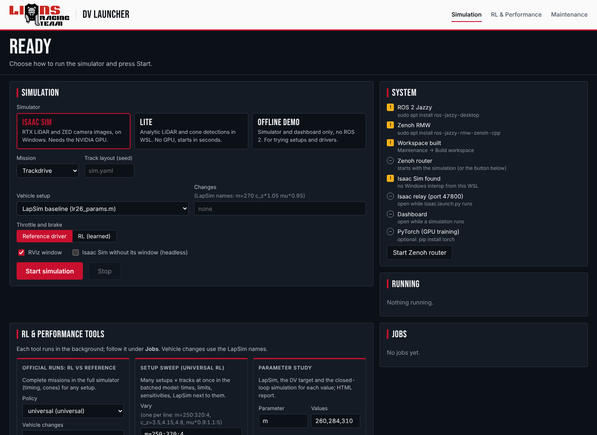

# Launcher: everything from one page (`run.bat`)

Double-click **`run.bat`** on Windows. It starts the launcher in WSL and opens
**http://localhost:8070** in your browser. From that page you start, stop and configure the whole
simulator, so no terminal is needed.

*(Screenshot taken on a machine without ROS 2 or Isaac Sim, hence the warnings under System. On a set-up laptop they are green.)*

## First start

The project lives on the Windows drive, for example `C:\formula_student\fsg-dv-sim`, and WSL runs it from
there (as `/mnt/c/formula_student/fsg-dv-sim`). Edits made in Windows are live: there is no zip to install.
colcon's `build/`, `install/` and `log/` go to `~/.fsg-dv-sim/colcon` on the Linux disk, which is fast.

1. **Start it:** double-click `FSG DV Launcher.bat` next to the project folder
   (`C:\formula_student\FSG DV Launcher.bat`), or `run.bat` inside it. Both are the same file. It runs:
   * the project folder it is in, or
   * a `fsg-dv-sim` folder next to it, or
   * as a fallback, `~/fsg-dv-sim` inside WSL.
2. **First time:** the launcher builds the ROS 2 workspace by itself. This takes about a minute, and you
   follow it under **Jobs**. After that it rebuilds only when files were added or a `setup.py`,
   `package.xml` or message changed. Python, launch and config edits need no build.
3. **WSL terminals:** to make `fsgsim`, `fsgrouter` and `fsgbuild` use this copy too, press
   **Maintenance → Use this copy in WSL terminals** once. It runs `tools/wsl/setup_shell.sh`, which backs
   up `~/.bashrc` first. The old copy in WSL (`~/fsg-dv-sim`) is then no longer used; you can delete it.
4. **The console window:** a small console window stays open: that is the launcher.
   **Closing it stops everything it started.** Double-clicking again while it runs just reopens the page.

The settings are at the top of the `.bat` file: `DISTRO` (default `Ubuntu-24.04`) and `PORT` (8070).

## Simulation

| Choice | What it starts |
|---|---|
| **Isaac Sim** | 1. the Zenoh router; 2. `isaac.launch.py` (relay, driver, RViz, dashboard); 3. once the relay listens on port 47800, Isaac Sim on Windows (`run_isaac.ps1`), with the mission, track seed, vehicle changes and headless option |
| **Lite** | the Zenoh router and `lite.launch.py` (no GPU, analytic LiDAR and cone detections) with mission, seed, vehicle changes and real-time factor |
| **Offline demo** | the simulator and dashboard in one process, no ROS 2 |

* **Common options:** mission, vehicle setup (below), throttle and brake (**Reference** or **RL**, with the RL policy) and RViz.
* **Camera cones (Isaac Sim):** **Cones for the driver: Ground truth / Camera (YOLO)** (with the detector to use) and **Record camera images for YOLO training**; see [PERCEPTION.md](PERCEPTION.md).
* **Cones for the driver** (lite and Isaac Sim): **Ground truth**, **LiDAR**, **LiDAR + camera**, **Camera + map**
  (the perception node, [PERCEPTION.md](PERCEPTION.md)) and, with Isaac Sim, **Camera (YOLO)**. With the first
  three: **Car position from SLAM** (no ground-truth pose) and, for trackdrive, **Race on the mapped track
  after** 1 or 2 laps. In Isaac Sim, LiDAR + camera and Camera + map need a trained cone detector. **Cone
  detector: Newest** takes the most recently trained one (until 13 Nov 2026 it stopped the start with "the relay
  did not open port 47800": the launcher passed an empty `cone_model:=`, which `ros2 launch` rejects).
* **Path on circuits:** centre line or racing line (reference driver, autocross and trackdrive; also in the
  offline demo). On ground-truth cones the driver follows the racing line from the start. With LiDAR / camera
  cones the track is not known before the first lap: the racing line needs trackdrive and **Race on the mapped
  track after** 1 or 2 laps (the launcher refuses it otherwise).
* **Handling model:** single track (LapSim axles, default) or double track (four wheels); sent to the simulator
  as `chassis.handling=double_track`, it does not appear in the vehicle setup.
* **Sensor faults:** e.g. `lidar:dropout@20+3, imu:bias=0.02@10`; the field is checked before the start.
* **Vehicle setup (before the start):** the Simulation panel has the configuration (saved in `lapsim/configs`,
  shared with the dashboard), the changes (`m=270 c_z*1.05 mux*0.95`) and a one-line LapSim / RL summary.
  **Edit parameters** (or the **Vehicle setup** tab at the top) opens a page like the dashboard's Vehicle setup:
  every parameter (documentation Table 3.1, LapSim's driver model per event, the driverless-only actuator limits)
  with its baseline from `lr26_params.m`; type a value or a factor such as `*1.05`. Next to it:
  * the **LapSim prediction** (the Python port, same numbers as LR26_LapSim): time and points per event against the baseline;
  * what the simulated car gets: LapSim and simulator parameters go to the simulation, the driver-model rows
    (`autocross.util_y=...`) only change the LapSim prediction;
  * which **RL policy** drives this car: one trained for exactly this car, a universal policy whose ranges cover it,
    or why none does (then the reference driver drives);
  * mistakes (unknown names, bad values); **Start simulation** refuses a setup with mistakes.

  **MATLAB** (same tab): **Run this setup in MATLAB** runs the real LR26_LapSim with the setup (in the background,
  its own work folder `%LOCALAPPDATA%\fsg-dv-sim\matlab\launcher`); its times and points appear as a MATLAB
  column next to LapSim's. Buttons open the last MATLAB results (results CSV, MATLAB's output, the job script, the
  results folder) and the LapSim files (`lr26_params.m`, the competition file, `run_lapsim.m`, the LR26_LapSim
  folder, the saved configurations) with their Windows program, or start the MATLAB desktop in LR26_LapSim.
  After editing `lr26_params.m`, press **Re-read MATLAB files**.

  **Save** / **Delete** manage configurations; **Back to the simulation** returns to the start form with the setup
  filled in. The launcher hands the setup (name and every change) to the dashboard (`vehicle_setup:=` launch
  argument, `--start-setup` for the offline demo): its Vehicle setup page shows it as the active setup, with the
  values in the form and the LapSim results. To change the car of a running simulation, edit it there and press
  **Apply** (the run restarts with the new car).
* **Starting:** **Start simulation** shows every step. When the dashboard is up, it opens in a new tab (**Open dashboard** if the browser blocked it).
* **Stopping:** **Stop** closes Isaac Sim and the ROS 2 processes. The Zenoh router keeps running for the next start.
* **While it runs:** use the dashboard as usual: Go, Emergency stop, and the Vehicle setup page that changes parameters in the running simulation.
* **Isaac Sim location:** `C:\isaacsim` by default. Change it under **Maintenance → Settings**, or give the `python.exe` of an Isaac Lab environment.

**System** shows what is installed and running: ROS 2, Zenoh, the built workspace, the router, Isaac Sim,
the relay, the dashboard, and PyTorch with or without CUDA. **Running** lists the processes, each with
its log and a Stop button.

## RL & Performance tools

**Performance Lab** (card at the top): **Open the Performance Lab** starts the stand-alone lap time simulation in
its own window on Windows (`perf\perf.bat`, which installs Python and its packages first if needed); **Its page**
opens http://localhost:8090 once it runs. It needs no WSL: the Performance department can use it without this
launcher. See [PERF_APP.md](PERF_APP.md).

Each tool runs as a background **job** with a live log. Finished jobs link their reports.

| Tool | Same as |
|---|---|
| Official runs: RL vs reference | `tools/train_rl_universal.py --evaluate rl/policies/<policy> --set ...` |
| Setup sweep (universal RL) | `tools/rl_spec_sweep.py --vary ...` (links: table and CSV) |
| Parameter study | `tools/param_study.py --param ... --values ... [--driver rl]` (link: HTML report) |
| Train the universal policy | `tools/train_rl_universal.py` on the CPU or the GPU (`--backend torch`), optionally continuing an existing policy |
| Train for one setup | `tools/train_rl.py --set ...` |
| Train the cone detector (YOLO) | `tools/train_cone_yolo.py --name ... --epochs ... --model yolo11n.pt` on the Windows Python (link: results); see [PERCEPTION.md](PERCEPTION.md) |

Results are written to `results/` in the repo, and policies to `rl/policies/`. The dashboard picks
policies up immediately.

## Share with Claude

* **Save report to the project:** writes `shared\<date>\` in the project folder with `report.md` and
  every complete log (`logs\*.log`); `shared\LATEST.md` is always the newest report. The report has the system
  state, the Windows Python, the settings, the simulation's steps, and each process and job with its command,
  exit code, result tables and log. Claude can read that folder directly: just say "I saved a report".
* **Copy report:** the same report with the last 200 lines of each log, on the clipboard, ready to paste
  into a chat.
* **Copy** next to every process or job copies its complete log. **Copy results** copies a finished job's
  tables (sweep table and CSV, the study's CSV). The log viewer has a **Copy** button too.

`shared/` is in `.gitignore`: reports stay on the PC.

## GPU jobs (PyTorch)

GPU training (**Train the universal policy → GPU**) and GPU sweeps run with the **Windows Python** when it
has PyTorch: the project is on `C:`, so Windows Python runs it directly, with CUDA on the NVIDIA GPU.
Without it they use PyTorch in WSL, if that is installed.

* **System → Windows Python (GPU jobs):** shows the Python it found (`where python`, or the one under
  Settings), its PyTorch version, the GPU, and any missing package.
* **Maintenance → Install packages for GPU jobs:** `pip install --user numpy pyyaml` for that Python
  (PyTorch you install yourself, e.g. `pip install torch`).
* **Maintenance → Check the GPU code (PyTorch tests):** runs `tests/test_vec.py` with that Python. Its
  PyTorch tests check that the GPU path gives the same results as the NumPy path. Run it once before a
  long GPU training.
* **System → GPU memory:** how much of the GPU memory is in use (every program, from `nvidia-smi`). Isaac
  Sim needs most of an 8 GB laptop GPU, so don't run a GPU training and the Isaac simulation at the same time;
  the launcher says so when you start one while the other runs.
* **A GPU training never loses its work:** each time the validation improves, the best policy so far and the
  training state are saved in `rl/policies/<name>`. If the GPU runs out of memory, the training waits 20 s,
  restarts the cars and goes on (three times in a row at most, then it stops with the best policy saved).
  Go on later with **Train the universal policy → Continue from = <name>**. Every 10 iterations the log
  shows `GPU x GB ours, y/z GB free`.

## Maintenance

* **Install update from zip:** unzips `fsg-dv-sim.zip` (next to the project folder, else in Downloads) over
  the project and builds it. You don't need this when the project is edited in place.
* **Diagnose WSL:** uptime and load, memory, the ROS 2 / simulator processes still running and the busiest
  processes in WSL (left-over nodes from stopped runs slow the next one down).
* **Check the installation:** `tools/check_install.py`, every part with the command that fixes it
  ([INSTALL.md](INSTALL.md)).
* **Regression run (quick / all):** `tools/regression.py`, the closed loop on all events, several circuits,
  driver rates, perception modes and sensor faults; the report is linked under Jobs
  (`results/regression_<time>/report.md`). Quick: about 30 s; all: 2-3 minutes.
* **Build workspace** (`fsgbuild`), **Run tests**, **Put run.bat on the desktop**, **Use this copy in WSL terminals**.
* **Settings:** Isaac Sim folder or Python, update zip, dashboard port, open the dashboard automatically.
  They are stored in `~/.config/fsg-dv-sim/launcher.json`.
* **Quit launcher:** stops the simulation, the jobs and the router it started, then the launcher itself.

## GitHub / GitLab

Maintenance → **GitHub / GitLab** commits this copy of the project and pushes the same commit to both
repositories (`tools/git_push.py`; it also runs from a WSL terminal, `--help`).

1. Create the two repositories on the websites, **empty** (no README or licence: the tool never force-pushes, so
   a remote with its own first commit is refused with a hint). Private is the safer choice.
2. Install **Git for Windows** (https://git-scm.com/download/win, default options). The launcher uses its
   `git.exe` through WSL, so the Git Credential Manager signs you in: the first push opens a browser window for
   GitHub and one for GitLab, then Windows remembers it. The launcher never sees or stores a password or token.
   Without Git for Windows it falls back to WSL's git, which needs SSH keys and `git@...` URLs.
3. Enter the two repository URLs (`https://github.com/<team>/<repo>.git`, `https://gitlab.com/<group>/<repo>.git`),
   the branch (default `main`) and, if `git config user.name / user.email` is not set, the author. **Save**.
4. **Check what would be pushed** lists the changed files. **Commit and push to both** asks for confirmation,
   creates the repository on the first run, commits everything that `.gitignore` lets through with your
   message, and pushes to GitHub, then GitLab. Both pushes are tried even if one fails; the job log says which.

**What is uploaded** (team decision, 13 Nov 2026): code, docs, tests and the trained models (`models/cones/*/model.onnx`,
`rl/policies/`). **Never uploaded**: the CAD (`cad/`, `*.stp`, `*.step`), the LR26 body and wheel USDs
(`assets/lr26/*.usda`) and the Performance department's LapSim (`lapsim/LR26_LapSim/`); recordings, results and
`shared/` were already ignored. These stay on the team drive ([INSTALL.md](INSTALL.md) step 2). Besides
`.gitignore`, the tool refuses a commit that would contain any of them, or a file over 95 MB (GitHub's limit is
100 MB): nothing is committed or pushed then, and the job log lists the files. Uploaded and worth a look:
`lapsim/configs/LionsLTS_*.json` (LR26 parameter sets for LionsLTS, used by the tests),
`ros2_ws/src/fsd_sim_bringup/config/vehicle.yaml` and `docs/img/cad_zed_view.png` (a render of the CAD body).

## Notes

* **Security:** the launcher only listens on `127.0.0.1`. Actions need a header that only its own page sends,
  so other web pages cannot start commands. All commands are built from checked fields (mission names,
  `name=value` vehicle changes, numbers), never from free text.
* **Without the launcher:** the terminals still work (`fsgrouter`, `fsgsim && ros2 launch ...`,
  `run_isaac.ps1`; see [WINDOWS_WSL.md](WINDOWS_WSL.md)). The launcher reuses a Zenoh router that you
  started yourself.
* **Logs:** `~/.cache/fsg-dv-sim/launcher/*.log` in WSL.
* **Run it inside WSL without `run.bat`:** `python3 ~/fsg-dv-sim/tools/launcher/launcher.py` (`--port`, `--no-browser`).
